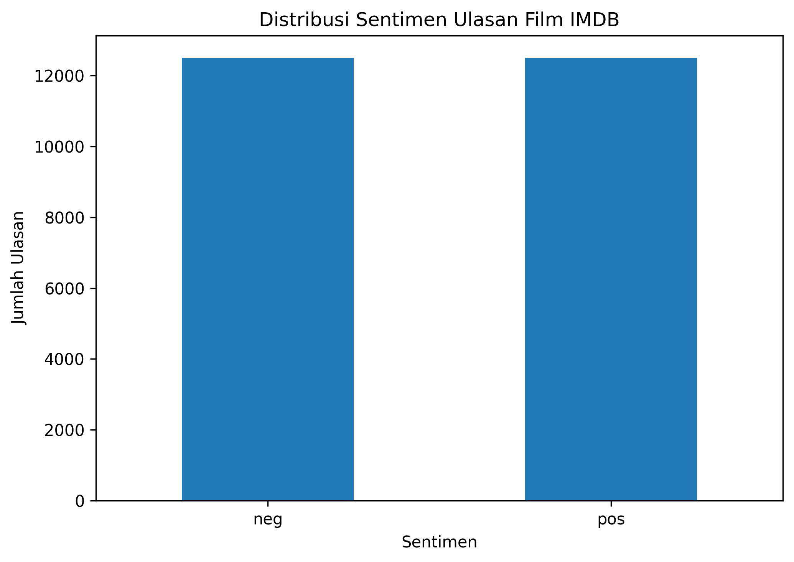
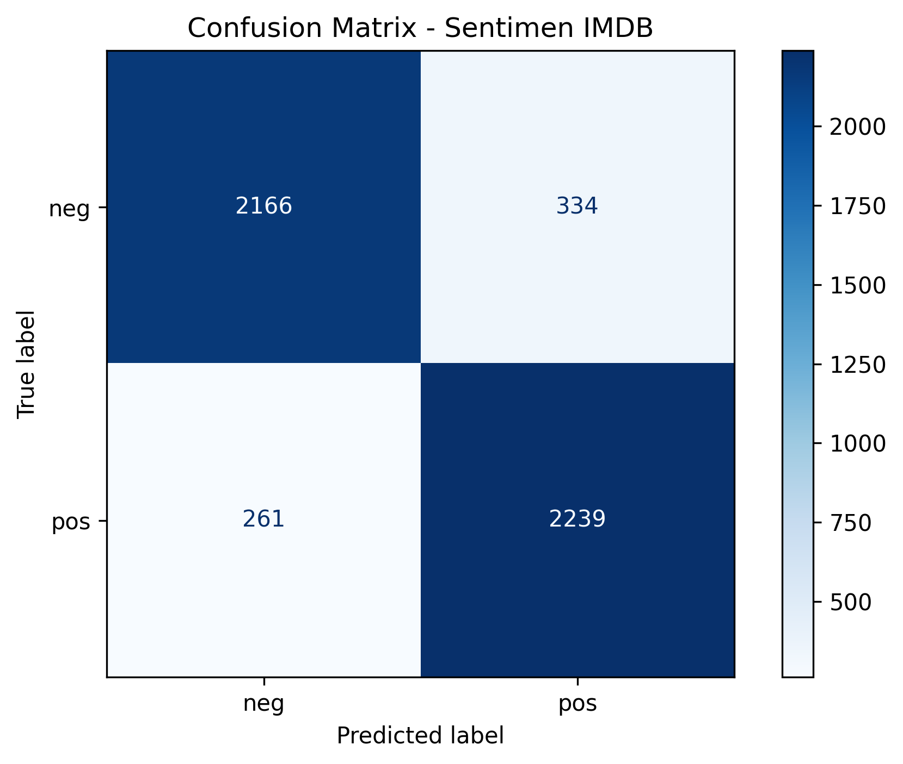

# IMDB Sentiment Analysis

Proyek Machine Learning untuk mengklasifikasikan ulasan film IMDB menjadi sentimen positif (*positive*) atau negatif (*negative*) menggunakan Python.

## Deskripsi Proyek

Analisis sentimen merupakan teknik untuk mengetahui opini atau perasaan seseorang berdasarkan teks. Pada proyek ini, model dilatih menggunakan ulasan film IMDB untuk memprediksi apakah sebuah ulasan memiliki sentimen positif atau negatif.

## Dataset

Dataset berasal dari Kaggle:

**IMDB 50K Movie Reviews (TEST your BERT)**

[Klik di sini untuk membuka dataset Kaggle](https://www.kaggle.com/datasets/atulanandjha/imdb-50k-movie-reviews-test-your-bert/data)

Dataset terdiri dari:

* `train.csv`: data untuk melatih model.
* `test.csv`: data untuk menguji prediksi model.

Dataset tidak disertakan di repository karena ukuran file yang besar.

## Teknologi yang Digunakan

* Python
* Pandas
* Matplotlib
* Scikit-learn
* Joblib

## Algoritma Machine Learning

### 1. TF-IDF

TF-IDF (*Term Frequency–Inverse Document Frequency*) mengubah teks ulasan menjadi representasi angka berdasarkan tingkat kepentingan kata dalam dokumen. Representasi ini digunakan sebagai masukan untuk model klasifikasi.

### 2. Logistic Regression

Logistic Regression digunakan untuk mengklasifikasikan ulasan menjadi sentimen positif atau negatif berdasarkan fitur yang dihasilkan TF-IDF.

### 3. Tahapan Proses

1. Membaca dataset.
2. Melakukan preprocessing teks dan label.
3. Membagi data latih menjadi data pelatihan dan validasi.
4. Mengubah teks menjadi fitur menggunakan TF-IDF.
5. Melatih model Logistic Regression.
6. Mengevaluasi model menggunakan akurasi, classification report, dan confusion matrix.
7. Melatih ulang model menggunakan seluruh data latih.
8. Membuat prediksi dan menyimpan hasilnya ke CSV.

## Hasil Evaluasi

Model menghasilkan nilai evaluasi berikut berdasarkan output program:

| Evaluasi             | Akurasi |
| -------------------- | ------: |
| Validasi             |  88,10% |
| Pengujian `test.csv` |  88,83% |

### Grafik Distribusi Sentimen

Grafik berikut menunjukkan jumlah ulasan positif dan negatif pada dataset pelatihan.



### Confusion Matrix

Confusion matrix memperlihatkan perbandingan antara sentimen sebenarnya dan hasil prediksi pada data validasi.



Hasil confusion matrix validasi:

| Sentimen sebenarnya | Prediksi negatif | Prediksi positif |
| ------------------- | ---------------: | ---------------: |
| Negatif             |            2.166 |              334 |
| Positif             |              261 |            2.239 |

Model mengklasifikasikan 4.405 dari 5.000 data validasi dengan benar.

## Kesimpulan

Berdasarkan hasil pengujian, model TF-IDF dan Logistic Regression mampu mengklasifikasikan ulasan film IMDB dengan akurasi validasi sebesar 88,10% dan akurasi pengujian sebesar 88,83%.

Hasil ini menunjukkan bahwa kombinasi TF-IDF dan Logistic Regression dapat digunakan sebagai pendekatan dasar untuk analisis sentimen teks. Namun, model masih melakukan kesalahan klasifikasi pada sebagian ulasan, sehingga peningkatan preprocessing, pemilihan fitur, dan pengujian algoritma lain dapat dipertimbangkan.

## Cara Menjalankan

1. Instal Python.

2. Unduh `train.csv` dan `test.csv` dari sumber dataset.

3. Letakkan kedua file CSV di folder yang sama dengan `ML,IMDB.py`.

4. Instal library yang diperlukan:

   ```bash
   pip install -r requirements.txt
   ```

5. Jalankan program:

   ```bash
   python "ML,IMDB.py"
   ```

6. Periksa file `hasil_prediksi.csv` dan `model_sentimen_imdb.pkl` yang dihasilkan program.

## Struktur Repository

```text
imdb-sentiment-analysis/
├── ML,IMDB.py
├── README.md
├── requirements.txt
├── grafik_distribusi_sentimen.png
└── grafik_confusion_matrix.png
```

## Pengembang

Proyek Machine Learning — Analisis Sentimen Ulasan Film IMDB.
